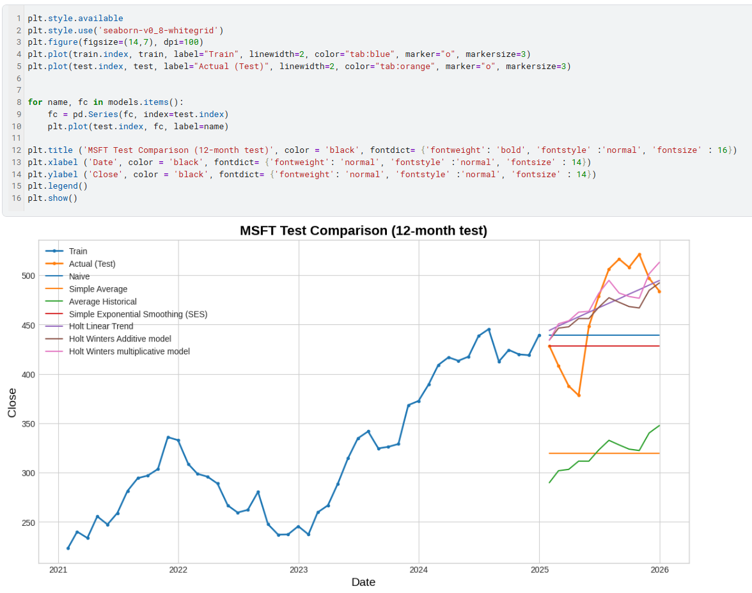

# Stock Price Forecasting with Time Series Methods

Forecasting 12 months of Microsoft (MSFT) monthly closing prices and comparing 10 forecasting methods.

## Data
- 5 years of daily MSFT closing prices (2021 to 2025), resampled to 60 monthly averages
- Train: 48 months (Jan 2021 to Dec 2024) | Test: 12 months (Jan to Dec 2025)

## Approach
1. Explored the series with rolling statistics and additive vs multiplicative decomposition
2. Built baseline forecasts: Naive, Simple Average, Average Historical
3. Applied exponential smoothing: Simple Exponential Smoothing, Holt Linear, Holt-Winters (additive and multiplicative)
4. Tested stationarity with ADF and KPSS, differenced the series, and used ACF/PACF plots
5. Selected ARIMA and SARIMA orders by AIC
6. Built a lag-based linear regression model
7. Compared all methods using MAE, RMSE, and MAPE

## Results
| Method | MAE | RMSE | MAPE |
|---|---|---|---|
| Holt-Winters Multiplicative | 30.90 | 39.38 | 7.12% |
| ARIMA(1,2,1) | 31.65 | 38.95 | 7.31% |
| Holt Linear Trend | 31.87 | 38.57 | 7.30% |
| Holt-Winters Additive | 32.39 | 39.67 | 7.30% |
| Naive | 49.93 | 54.91 | 10.66% |
| SARIMA(0,2,2)(1,1,2,12) | 115.00 | 120.82 | 25.33% |
| Simple Average | 143.86 | 152.09 | 30.20% |

- Holt-Winters Multiplicative achieved the lowest MAE and MAPE, capturing both trend and seasonality
- ARIMA(1,2,1) was a close alternative
- SARIMA and lag-based regression overfit and performed poorly on the test period

## Tools
Python (pandas, NumPy, statsmodels, scikit-learn, Matplotlib, Seaborn), Kaggle
